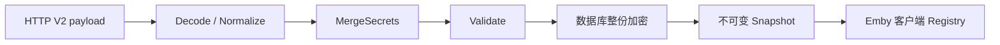

# mediaconfig 设计

## 目标与非目标

本包为媒体服务器配置提供确定、可验证且可安全复制的领域表示，避免 V2 JSON、加密存储和运行时客户端共享可变切片或宿主机路径语义。

本包不负责持久化加密、权限、HTTP 状态码、客户端连接或媒体查询。

## 配置流

## 关键决策

| 决策 | 理由 |
| --- | --- |
| 稳定 UUID 写回配置 | 名称和顺序可变化，持久任务必须引用不变身份 |
| required 为首个启用 Emby | 首版每个整理批次只固化一个必须跟踪的入库确认目标；它不阻塞新任务订阅结算 |
| API Key 空值合并旧值 | 官方前端读取到脱敏设置后仍能安全编辑其他字段 |
| 名称和 API Key 在领域边界限制字节数 | 让 HTTP、加密存储和 Emby 客户端对同一输入给出一致结果 |
| URL 拒绝 userinfo、query、fragment | 防止凭据进入 URL、代理和日志 |
| 路径映射使用词法组件比较 | 远端 Windows/POSIX 规则不能由当前宿主机决定 |
| 最长根优先 | 支持通用根与更具体媒体目录同时配置 |

## 已知限制

- 首版只接受 `emby`，Jellyfin/Plex 不在当前范围。
- required 选择当前不可由用户单独指定，按启用顺序确定。
- 路径映射只做词法转换，不访问远端文件系统验证目录存在。
- 名称上限为 255 个 UTF-8 字节，API Key 上限为 4096 个 UTF-8 字节；这两个限制按持久化和客户端边界定义，不按 Unicode 字符数定义。

## 安全措施

- `RedactSecrets` 不修改原快照，防止脱敏操作污染运行态。
- 端点拒绝控制字符、userinfo、query 和 fragment。
- 路径映射检查组件边界，避免 `/media/a` 错配 `/media/ab`。
- 实际 AES-256-GCM 加密由数据库适配器使用环境主密钥执行。

## 备选方案

- 未允许任意长度字段进入数据库后再处理，因为这会让相同配置在 HTTP、PostgreSQL 和 Emby 客户端得到不同结果。
- 未把端点指纹放入本包的持久模型，因为它是媒体索引请求的不可变执行快照；应用运行时基于已规范化的类型和 Host 计算即可。

## 变更历史

- 2026-08-15：required Emby 从新任务订阅完成门禁改为独立入库确认目标；遗留 `pending_index` 行仍按原目标有条件确认。
- 2026-08-12：增加名称 255 字节和 API Key 4096 字节边界，并补齐 ASCII 与多字节字符边界测试。
