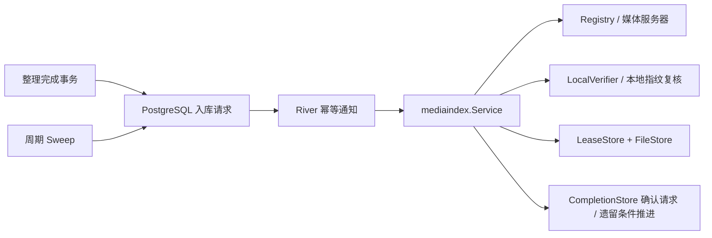

# mediaindex 设计

## 目标与非目标

目标是把 Emby 扫描延迟和故障从文件整理及普通订阅结算中分离，并可靠记录 required 媒体服务器的唯一入库确认。对于目标 episode 集已经正确建立的普通电影/电视剧，episode 和父订阅在 qBittorrent 明确接受资源且 `AcceptDownloadIntent` 事务成功时结算；媒体索引状态必须可在进程崩溃、River 漏入队和媒体服务器重启后恢复。

本包不负责 HTTP、配置加密、数据库 SQL、River Worker 注册、文件整理或 V2 响应转换，也不保存 Redis 状态。

## 数据流

PostgreSQL 请求是事实源，River 只负责唤醒。整理事务提交后即使即时入队失败，sweep 仍能重新发现请求。

## 状态与执行语义

- `pending`：尚未刷新，可领取。
- `working`：由 token-CAS 租约持有。
- `failed`：本次未确认，已持久化下一次执行时间，仍可恢复。
- `confirmed`：全部文件唯一确认，请求完成事务已提交；新任务订阅状态不依赖该状态。

每次 `Handle` 只做一个有界阶段：首次领取发送一次刷新；之后每次最多读取 16 个文件。处理期间使用独立子上下文每 30 秒续租，调用完成、父上下文取消或续租失败时心跳 goroutine 都会退出。Worker 内不循环等待，也不使用长期 `Sleep`。

## 关键决策

| 决策 | 理由 |
| --- | --- |
| 接口定义在消费方并按职责拆分 | 避免数据库适配器类型和大接口进入业务域 |
| 请求固化服务器 ID、类型和端点指纹 | 同一 UUID 改指其他 Host 后，旧请求不能在错误服务器上确认 |
| Emby 查询前复核本地大小与 SHA-256 | 避免整理后文件被替换仍凭远端旧条目确认入库请求 |
| 路径风格与大小写策略随文件持久化 | Windows/POSIX 比较不能依赖运行 Worker 的宿主系统 |
| 唯一路径匹配后再校验 Provider ID | 防止同名旧媒体或错误外部 ID 造成假阳性 |
| 歧义、路径不符和 Provider 不符独立分类 | 保留可观测性，避免错误修复方向被误导 |
| 正常等待返回成功 | 不消耗 River 的有限重试，等待由数据库调度 |
| 刷新结果未知时进入确认阶段 | POST 可能已到达 Emby，直接重试会触发扫描风暴 |

## 已知限制

- 首版每个整理批次只固化一个 required 媒体服务器。
- 当前整理计划通常只能提供路径和指纹；季集坐标与 Provider ID 仅在上游可靠提供时使用。
- `attempt_count` 只用于遥测，不作为停止恢复的业务条件。
- `pending_index` 只用于升级前遗留订阅；确认事务仅在 parent/current intent 仍匹配时推进，已结算或已切换 intent 时幂等不改订阅状态。
- organization 对普通订阅的新状态不再修改订阅；`pending_organization/organizing/pending_index/indexed` 的推进仅为 legacy 兼容。
- 目标 episode 集建立仍有上游兼容缺口；洗版 `current_priority/episode_priority` 和优先级 `100` 完成判定尚未实现，均不属于本包的普通订阅结算保证。

## 安全与可靠性

- 业务错误只暴露稳定分类；上游错误正文、Token、路径和 Provider ID 不进入持久错误。
- 所有阻塞调用传播 `context.Context`。
- 续租失败或 token-CAS 所有权丢失时返回稳定的 `ErrLeaseLost`，等待 sweep 恢复，而不再尝试写入旧租约。
- 文件确认和请求完成均使用租约 token CAS；重复确认同一 item ID 幂等。
- Redis 和进程内内存不参与事实状态判断。

## 备选方案

- 未采用“一个请求持有租约直至扫描完成”的长轮询方式，因为它会占用 Worker、放大重启恢复时间并增加 goroutine 泄漏风险。
- 未仅按服务器 UUID 恢复客户端，因为 UUID 可被保留但端点已改变；端点指纹提供了不可变请求与当前运行时之间的校验。
- 未把本地指纹结果缓存到 Redis，因为文件当前状态属于入库确认依据，必须在副作用前直接复核。

## 变更历史

- 2026-08-15：目标集正确的普通电影/电视剧结算前移到下载接受事务；organization 和 required 媒体索引均不再改变或阻塞普通订阅，legacy 条件推进保留。
- 2026-08-15：新任务订阅结算与 required 媒体索引确认解耦；`pending_index` 仅保留升级前遗留行的有条件推进。
- 2026-08-12：加入端点指纹校验、本地文件复核、30 秒租约心跳和精确匹配错误分类；移除尝试次数的业务停止语义。
